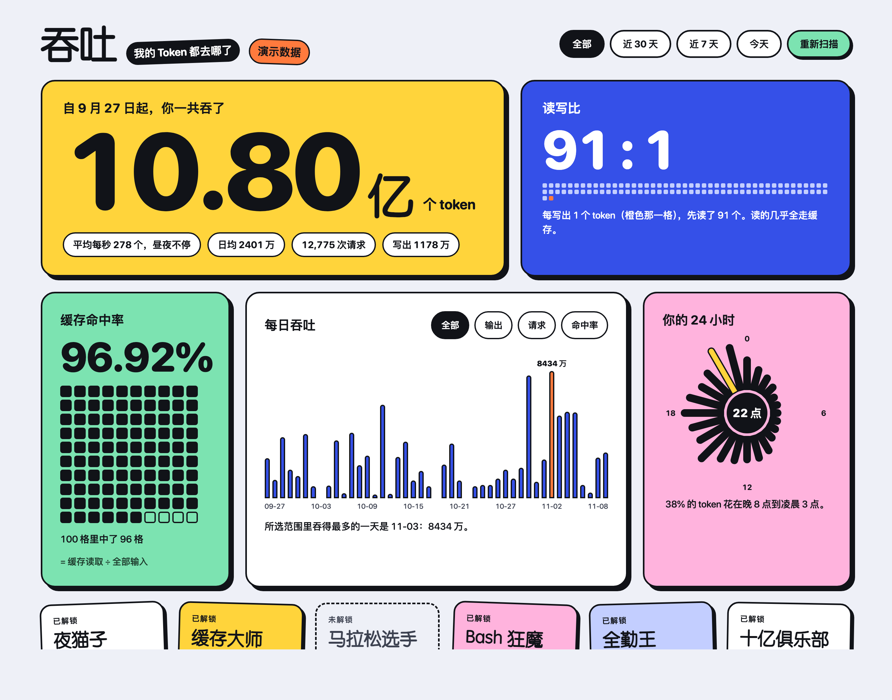
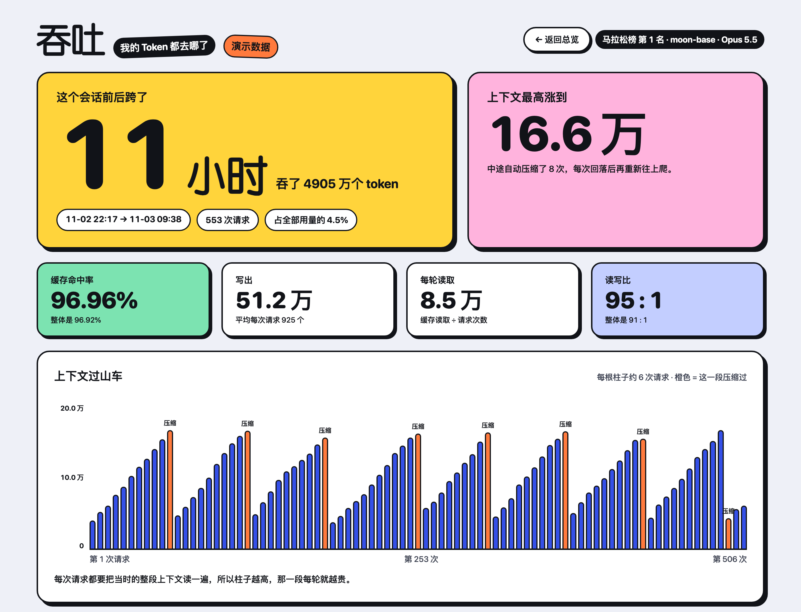

# tuntu (吞吐)

Where did all my tokens go? A local dashboard for your Claude Code token usage.

tuntu reads the session logs Claude Code already keeps on your machine and shows them in a playful one-page dashboard. It has no dependencies, and nothing leaves your computer. The name is Chinese for "throughput", and the dashboard UI is in Chinese.



Open any session to watch its context grow, get auto-compacted, and grow again:



(The screenshots use synthetic data from `--demo` mode.)

## Run it

Requires Python 3.9 or later. There are no third-party dependencies.

Run it without installing (needs [uv](https://docs.astral.sh/uv/)):

```bash
uvx tuntu
```

Or install it as a command:

```bash
pipx install tuntu
```

```bash
tuntu
```

Or run it straight from source:

```bash
git clone https://github.com/shnehna/tuntu.git
cd tuntu
python3 -m tuntu
```

It scans the session logs under `~/.claude/projects` and opens `http://127.0.0.1:8787/` in your browser.

No logs yet, or just want to see what it looks like? Demo mode is also the safe way to take screenshots:

```bash
tuntu --demo
```

| Option | What it does |
|---|---|
| `--demo` | Show synthetic data; no logs are read |
| `--dir PATH` | Log directory (default `~/.claude/projects`; `CLAUDE_CONFIG_DIR` is also honored) |
| `--port N` | Port, default 8787; the next free port is used if it is taken |
| `--no-open` | Do not open the browser |
| `--web-fonts` | Load display fonts from Google Fonts for a look closer to the original design (makes external requests) |
| `--json` | Print the aggregated data as JSON and exit |
| `--version` | Print the version |

## What you get

- **Total**: how many tokens you have used, the average per second, and the daily average.
- **Read/write ratio**: how many tokens were read for every token written.
- **Cache hit rate**: cache reads ÷ all input.
- **Daily usage**: switch between all tokens, output, request count, and hit rate.
- **24-hour clock and weekly heatmap**: when you use it most.
- **Composition**: the split between cache reads, cache writes, output, and uncached input; the share of cache writes in the 1-hour tier; the share used by subagents.
- **Effort, model, project, tool**: the breakdown by each.
- **Session leaderboard**: the sessions that used the most tokens. Open one to see its context length grow and get auto-compacted.
- **Achievement stickers**: Night Owl, Cache Master, Marathon Runner, and more.

The time range can be set to all time, the last 30 days, the last 7 days, or today.

## Privacy

- The server listens on `127.0.0.1` only and rejects requests whose Host header is not local.
- No external requests are made by default, and the page ships with a CSP that blocks external resources. Google Fonts is contacted only if you pass `--web-fonts`.
- Only usage numbers, timestamps, model names, tool names, and working directory names are taken from the logs. Conversation content is never stored, displayed, or sent anywhere.
- Projects are shown by directory name only, never the full path. Your home directory is shown as `~`.
- Nothing is written to disk and nothing is cached. Close it and nothing is left behind.

Before sharing a screenshot, remember that project names and tool names come from your own machine. For an image with no personal details, use `--demo`.

## How the numbers are calculated

- The data comes from the `usage` field of each request in the session logs (`*.jsonl`) that Claude Code writes locally.
- A single message can appear on several log lines. Messages are deduplicated before they are summed.
- Resumed or forked sessions carry a copy of the earlier history. Totals count each message once, but the leaderboard counts each session's full history, so the sessions add up to more than the total.
- Projects are grouped by the directory the session started in. Sessions in a worktree are grouped under the original project.
- A session's span is the time from its first request to its last, which can include long idle gaps.
- Times are shown in your local time zone.
- Claude Code keeps logs for a limited time (the `cleanupPeriodDays` setting). Older usage is no longer on your machine, so it cannot be shown here.
- Only Claude Code on this machine is counted. Conversations on claude.ai or the mobile apps are not included.
- These numbers are estimates from local logs, not a bill. The official usage page is the source of truth.

## Layout

```
tuntu/cli.py           log scanning, aggregation, and the local HTTP server (standard library only)
tuntu/web/index.html   the page (a single file, plain JavaScript, no dependencies)
pyproject.toml         packaging configuration
```

## Releasing a new version (maintainers)

1. Update `__version__` in `tuntu/__init__.py`.
2. Build and upload:

```bash
uv build
```

```bash
uv publish
```

## Disclaimer

This is a personal project and is not affiliated with Anthropic. Claude and Claude Code are trademarks of Anthropic.

## License

MIT. See [LICENSE](LICENSE).
